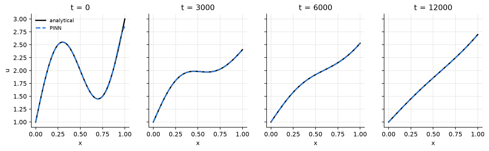
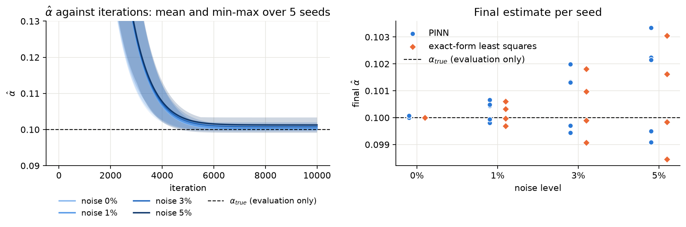
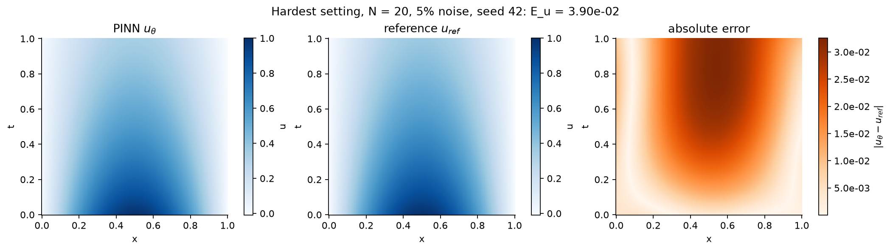

<div align="center">

# PINN Heat Equation

**Physics-informed neural networks for the 1D heat equation, solved both ways: a forward PINN benchmarked against the analytic series and a hand-written finite-difference scheme, and an inverse PINN that recovers the unknown thermal diffusivity from sparse, noisy measurements.**


-0.026%25-d97742)

English · [Русский](README.ru.md)

</div>

---

| Part | Problem | Headline |
|---|---|---|
| [`forward/`](forward) | $u_t=\beta u_{xx}$ with mixed Dirichlet / Neumann boundaries and a corner incompatibility, $T=12000$ | PINN reaches RMSE ≈ $1.3\cdot10^{-3}$ **without any labels**, beating the explicit Euler scheme with a 1st-order Neumann BC. A 2nd-order BC on the same grid still beats the PINN. |
| [`inverse/`](inverse) | $u_t=\alpha u_{xx}$ with unknown $\alpha$, observed at 20–100 noisy points | $\hat\alpha$ mean error **0.026%** on clean data (N = 100, 5 seeds), error ≈ the Cramér–Rao bound under noise |

## Forward problem: PINN vs analytic vs Euler

<p align="center"></p>

- **Analytic reference.** Steady state plus a Fourier series with eigenvalues $k_n=(n+\tfrac12)\pi$. The coefficients are derived by hand and checked with SymPy and quadrature.
- **Explicit Euler, written from scratch.** Stability $s=0.32\le\tfrac12$ is verified, and it blows up to `nan` at $s=1.28$ as theory predicts. A grid-refinement study confirms the measured order: **1.0** with the 1st-order Neumann BC and **2.0** with a ghost-point BC. The Neumann approximation, not the interior stencil, limits accuracy.
- **PINN.** A 3×32 tanh network on $(x,\tau)$ with time rescaling $\tau=t/T$. The key trick is **weighting the physics loss by $T^2=1.44\cdot10^8$**: with weight 1 the network learns the boundary conditions but ignores the PDE (RMSE 0.61–0.77, worse than the steady state). Results are averaged over 3 seeds.

| Method, RMSE at t = 3000 / 6000 / 12000 | | | |
|---|---|---|---|
| Euler, Δx = 1/40, 1st-order Neumann | 9.3e-3 | 5.2e-3 | 2.3e-3 |
| **PINN, mean of 3 seeds** | **1.3e-3** | **1.2e-3** | **9.6e-4** |
| Euler, Δx = 1/40, 2nd-order Neumann | 9.9e-4 | 6.5e-4 | 4.1e-4 |
| Steady-state baseline | 0.35 | 0.25 | 0.18 |

**Verdict:** for a 1D linear problem the classical scheme wins on cost. At equal error, Euler is more than 1,000× faster than training the PINN. The PINN is still label-free, more accurate than the prescribed scheme, and seed-dependent.

## Inverse problem: recovering α

<p align="center">
  
  
</p>

$\alpha$ is a trainable parameter next to the network weights. Only the data and PDE residual losses see it, and $\alpha_{true}=0.1$ is used only to measure errors.

| Setting (5 seeds) | Error in α | Field error $E_u$ |
|---|---|---|
| N = 100, clean | 0.026% | 0.08% |
| N = 20, clean | 0.07% | 0.09% |
| N = 100, 5% noise | 1.8% | 1.0% |
| N = 20, 5% noise | 4.2% (worst 9.8%) | 1.9% |

- **Sparse data is fine:** 20 clean points are enough. The field error does not depend on N, so the network fit is the bottleneck, not the data.
- **Under noise the PINN matches least squares on the exact formula** and stays near the **Cramér–Rao bound**, so the error comes from the data, not the network. $L_{data}\approx\sigma^2$: no overfitting to noise.
- **Identifiability check.** Without measurements α stays at its initial value, while the loss is tiny and the field is wrong, so a small loss alone proves nothing. Starting far away ($\alpha_0=5$) sometimes fails at 10k iterations and always converges at 30k. The failure is visible from the losses alone, with no ground truth needed.
- **Honest baseline:** for this one-mode problem, least squares on the closed form takes under a millisecond and is just as accurate. A PINN pays off when no closed form exists.

## Run it

```bash
python -m venv .venv && source .venv/bin/activate
pip install -r forward/requirements.txt -r inverse/requirements.txt
cd forward && jupyter nbconvert --to notebook --execute --inplace --ExecutePreprocessor.timeout=7200 notebooks/forward_heat_pinn_en.ipynb
cd ../inverse && jupyter nbconvert --to notebook --execute --inplace --ExecutePreprocessor.timeout=7200 notebooks/inverse_heat_pinn.ipynb
```

The forward part trains 15 PINNs (≈1 h on an Apple M4 CPU, or minutes when cached weights exist). The inverse part trains 77 models in ≈47 min, and two full runs gave identical tables. No GPU is needed.

```text
forward/src/   problem definition, analytic series, Euler scheme, PINN, metrics, experiment runner
forward/notebooks/forward_heat_pinn_en.ipynb   English notebook (forward_heat_pinn.ipynb is the Russian one)
inverse/notebooks/inverse_heat_pinn.ipynb      derivations, all experiments, figures
*/results/     every figure and table;  */REPORT.ru.md  the full write-ups (in Russian)
```

Related: [pinn-viscoacoustic-wave](https://github.com/AlisherKshtykenov/pinn-viscoacoustic-wave), a PINN for the 2D viscoacoustic wave equation in a heterogeneous medium (divergence vs direct form) · [xpinn-material-interface](https://github.com/AlisherKshtykenov/xpinn-material-interface), an XPINN across a material interface.

## License

[MIT](LICENSE)
