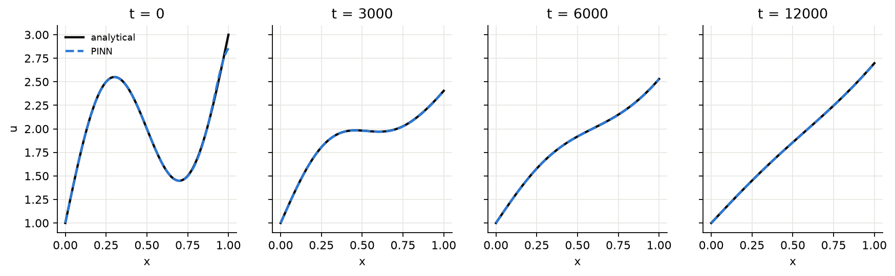
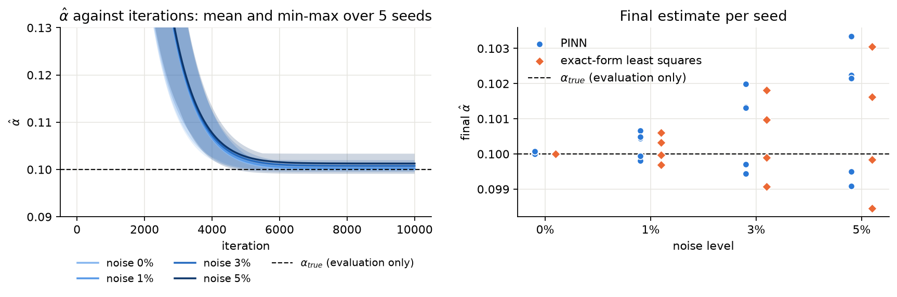
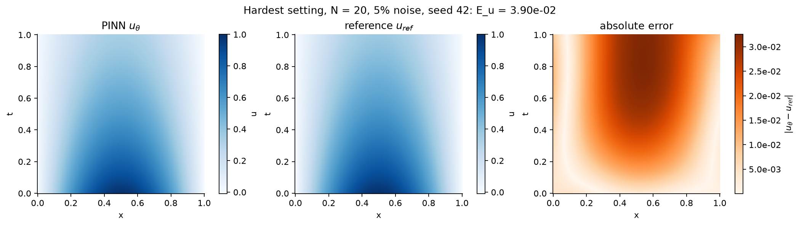

<div align="center">

# PINN Heat Equation

**Физически информированные нейросети (PINN) для одномерного уравнения теплопроводности в обе стороны. Прямой PINN сравнивается с аналитическим рядом и написанной вручную разностной схемой. Обратный PINN по редким зашумлённым замерам восстанавливает неизвестную температуропроводность.**


-0.026%25-d97742)

[English](README.md) · Русский

</div>

---

| Часть | Задача | Главное |
|---|---|---|
| [`forward/`](forward) | $u_t=\beta u_{xx}$ со смешанными условиями Дирихле / Неймана и несогласованностью в углу, $T=12000$ | PINN даёт RMSE ≈ $1.3\cdot10^{-3}$ **без единой метки** и обходит явную схему Эйлера с условием Неймана 1-го порядка. Условие 2-го порядка на той же сетке всё равно точнее PINN. |
| [`inverse/`](inverse) | $u_t=\alpha u_{xx}$ с неизвестным $\alpha$, 20–100 зашумлённых замеров | средняя ошибка $\hat\alpha$ **0.026%** на чистых данных (N = 100, 5 seed); при шуме ошибка около границы Крамера–Рао |

## Прямая задача: PINN против аналитики и Эйлера

<p align="center"></p>

- **Аналитический эталон.** Стационарный профиль плюс ряд Фурье с собственными числами $k_n=(n+\tfrac12)\pi$. Коэффициенты выведены вручную и проверены через SymPy и квадратуру.
- **Явная схема Эйлера, написанная с нуля.** Устойчивость $s=0.32\le\tfrac12$ проверена; при $s=1.28$ решение, как и предсказывает теория, уходит в `nan`. Измельчение сетки подтверждает порядок: **1.0** с условием Неймана 1-го порядка и **2.0** с фиктивной точкой. Точность ограничивает аппроксимация условия Неймана, а не внутренний шаблон.
- **PINN.** Сеть 3×32 tanh на $(x,\tau)$ с масштабом времени $\tau=t/T$. Ключевой приём — **вес физической потери $T^2=1.44\cdot10^8$**: с весом 1 сеть выучивает граничные условия, но игнорирует уравнение (RMSE 0.61–0.77, хуже стационарного профиля). Результаты усреднены по 3 seed.

| Метод, RMSE при t = 3000 / 6000 / 12000 | | | |
|---|---|---|---|
| Эйлер, Δx = 1/40, Нейман 1-го порядка | 9.3e-3 | 5.2e-3 | 2.3e-3 |
| **PINN, среднее по 3 seed** | **1.3e-3** | **1.2e-3** | **9.6e-4** |
| Эйлер, Δx = 1/40, Нейман 2-го порядка | 9.9e-4 | 6.5e-4 | 4.1e-4 |
| Стационарный профиль | 0.35 | 0.25 | 0.18 |

**Итог:** для одномерной линейной задачи классическая схема выгоднее по стоимости: при равной ошибке Эйлер быстрее обучения PINN более чем в 1000 раз. PINN обходится без меток и точнее заданной схемы, но зависит от seed.

## Обратная задача: восстановление α

<p align="center">
  
  
</p>

$\alpha$ обучается как параметр рядом с весами сети. Его видят только потери по данным и невязка уравнения, а $\alpha_{true}=0.1$ используется только для подсчёта ошибок.

| Условия (5 seed) | Ошибка α | Ошибка поля $E_u$ |
|---|---|---|
| N = 100, без шума | 0.026% | 0.08% |
| N = 20, без шума | 0.07% | 0.09% |
| N = 100, шум 5% | 1.8% | 1.0% |
| N = 20, шум 5% | 4.2% (худший 9.8%) | 1.9% |

- **Редких данных хватает:** 20 чистых точек достаточно. Ошибка поля не зависит от N, значит узкое место — обучение сети, а не данные.
- **При шуме PINN совпадает с МНК по точной формуле** и держится около **границы Крамера–Рао**, то есть ошибка определяется данными, а не сетью. $L_{data}\approx\sigma^2$: переобучения на шум нет.
- **Проверка идентифицируемости.** Без замеров α остаётся у стартового значения: потеря при этом крошечная, а поле неверное. Поэтому малая потеря сама по себе ничего не доказывает. Далёкий старт ($\alpha_0=5$) иногда не сходится за 10k итераций, но всегда сходится за 30k. Неудачу видно по одним потерям, без знания истины.
- **Честный baseline:** для этой одномодовой задачи МНК по готовой формуле занимает меньше миллисекунды и так же точен. PINN окупается там, где формулы нет.

## Запуск

```bash
python -m venv .venv && source .venv/bin/activate
pip install -r forward/requirements.txt -r inverse/requirements.txt
cd forward && jupyter nbconvert --to notebook --execute --inplace --ExecutePreprocessor.timeout=7200 notebooks/forward_heat_pinn.ipynb
cd ../inverse && jupyter nbconvert --to notebook --execute --inplace --ExecutePreprocessor.timeout=7200 notebooks/inverse_heat_pinn.ipynb
```

Прямая часть обучает 15 PINN (≈1 ч на CPU Apple M4 или несколько минут, если есть кэш весов). Обратная обучает 77 моделей за ≈47 мин, и два полных прогона дали одинаковые таблицы. GPU не нужен.

```text
forward/src/   постановка, аналитический ряд, схема Эйлера, PINN, метрики, запуск экспериментов
forward/notebooks/forward_heat_pinn.ipynb      русский ноутбук (forward_heat_pinn_en.ipynb — английский)
inverse/notebooks/inverse_heat_pinn.ipynb      выводы формул, все эксперименты, графики
*/results/     все графики и таблицы;  */REPORT.ru.md  подробные отчёты
```

Связанный проект: [pinn-viscoacoustic-wave](https://github.com/AlisherKshtykenov/pinn-viscoacoustic-wave), PINN для 2D вязкоакустического волнового уравнения в неоднородной среде (дивергентная и прямая форма) · [xpinn-material-interface](https://github.com/AlisherKshtykenov/xpinn-material-interface), XPINN на границе двух материалов.

## Лицензия

[MIT](LICENSE)
